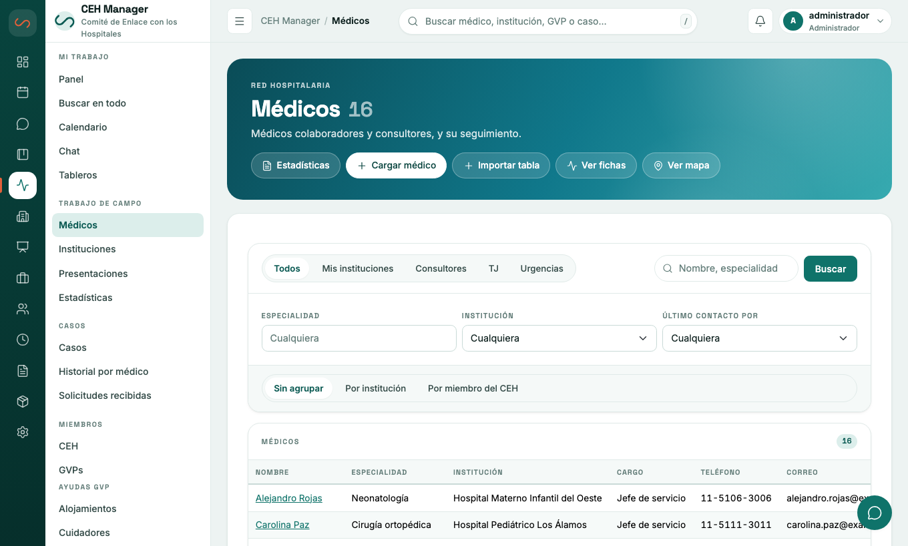
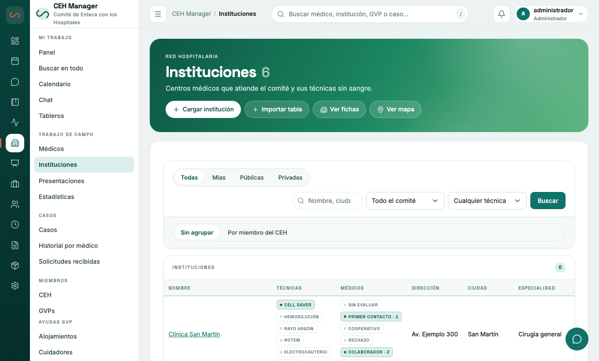
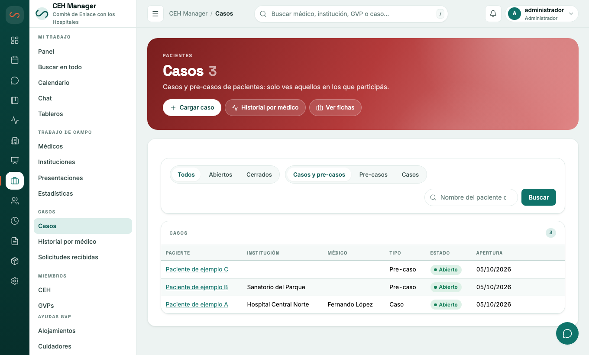
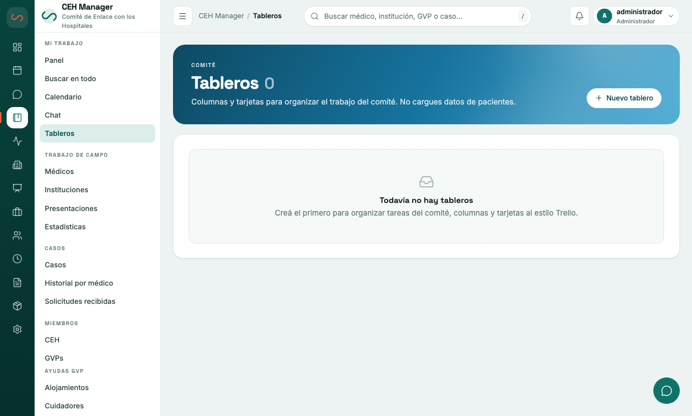
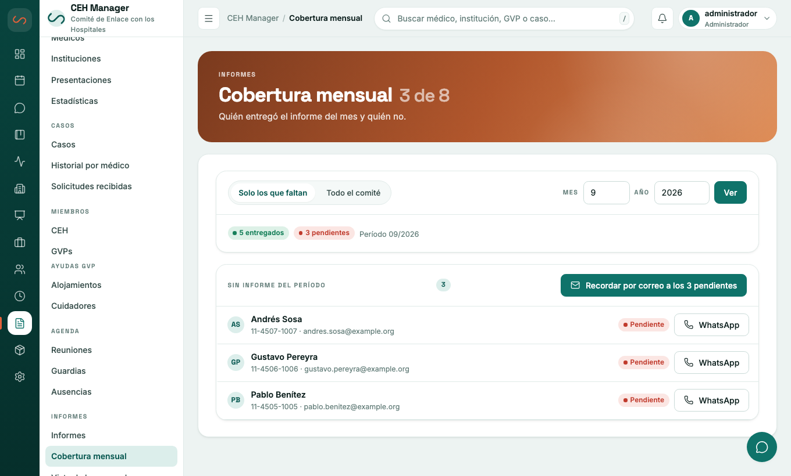
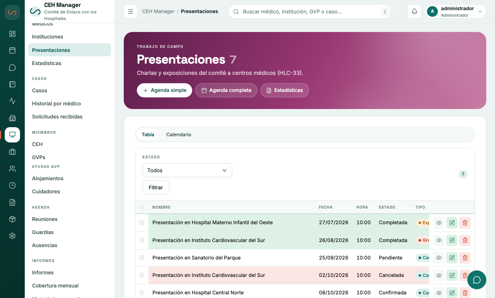
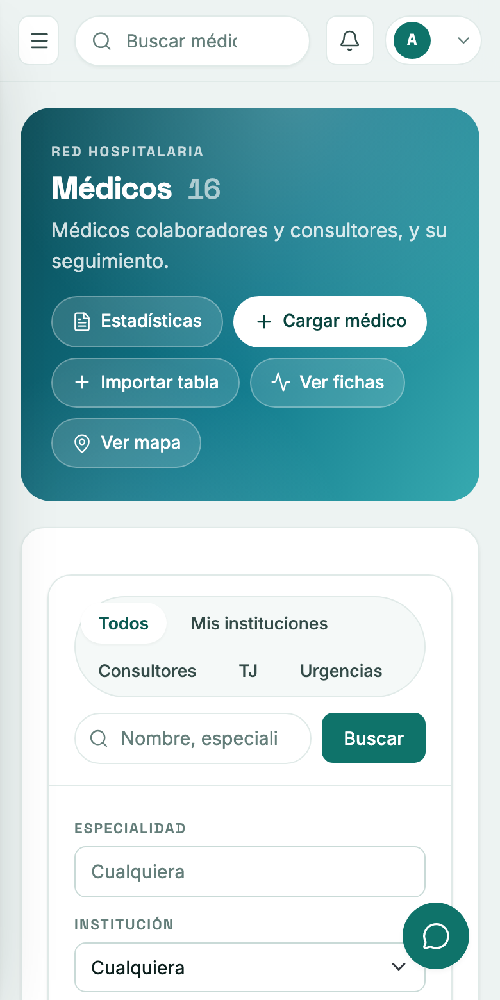

<h1 align="center">CEH Manager</h1>

<p align="center">
  <strong>El sistema del Comité de Enlace con los Hospitales para llevar todo en un solo lugar.</strong><br>
  Médicos e instituciones, casos, reuniones, guardias, agenda, informes, actas y chat del comité.
</p>

<p align="center">
  <a href="https://github.com/ceh-teams/ceh-releases/releases/latest"><strong>⬇️ Descargar la última versión</strong></a>
  &nbsp;·&nbsp;
  <a href="#cómo-empezar">Cómo empezar</a>
  &nbsp;·&nbsp;
  <a href="#código-fuente-y-reporte-de-errores">Código fuente y errores</a>
</p>

<p align="center">
  
</p>

<p align="center"><sub>Las capturas son del modo demo, con datos inventados.</sub></p>

## Para qué sirve

- 🩺 **Médicos e instituciones ordenados**: fichas, tabla y mapa, con filtros por especialidad, consultores y urgencias. Avisa cuándo hace falta volver a comunicarse con alguien («al día», «por vencer», «vencido»).
- 📋 **Seguimiento de cada caso**: paciente, médico e institución, notas, tareas, laboratorios y personas asignadas. Las solicitudes pueden llegar solas desde un formulario en internet.
- 📅 **Organización del comité**: reuniones con confirmación de asistencia, guardias, ausencias y un calendario compartido.
- 📊 **Informes y presentaciones**: informes mensuales con cobertura por miembro, estadísticas y los formularios oficiales en PDF (HLC-7, HLC-29, HLC-31, HLC-33, CEH-3), generados en tu propio equipo.
- 🗂️ **Actas, correspondencia y bienes**, con avisos de vencimiento.
- 💬 **Chat y tableros de tareas** tipo Kanban, con avisos en el sistema y en el celular.
- 📥 **Carga de listas** de médicos e instituciones desde Excel o CSV, con vista previa y sin duplicar.
- ✨ **Asistente de inteligencia artificial** (opcional): responde preguntas sobre los datos y carga información **solo si vos lo confirmás**.

## Un vistazo

<table>
  <tr>
    <td width="50%"><br><sub><b>Instituciones</b> — hospitales, clínicas y farmacias, con quién del comité está a cargo.</sub></td>
    <td width="50%"><br><sub><b>Casos</b> — seguimiento de pacientes, médicos e instituciones.</sub></td>
  </tr>
  <tr>
    <td><br><sub><b>Agenda</b> — reuniones, guardias y ausencias en un calendario unificado.</sub></td>
    <td><br><sub><b>Tableros</b> — tareas del comité en columnas y tarjetas.</sub></td>
  </tr>
  <tr>
    <td><br><sub><b>Informes</b> — entrega mensual y cobertura de cada miembro.</sub></td>
    <td><br><sub><b>Presentaciones</b> — agenda, estado y estadísticas.</sub></td>
  </tr>
</table>

### También en el celular

<p align="center">
  
</p>

Funciona en el navegador, adaptado a pantallas chicas, y se puede instalar como una app.

## Tus datos están protegidos

- 🔐 **Cifrado por campo**: los datos de personas se guardan ilegibles para quien no tenga la clave.
- 🔒 **Arranca bloqueado**: al encender el sistema, nadie entra hasta que se escribe la **frase maestra**. Quien se lleve el equipo apagado no puede leer nada. Hay un **kit de recuperación** para guardar en papel.
- 🛡️ **Cada persona con su cuenta**, verificación en dos pasos, llaves de acceso o biometría, permisos por sección y registro de quién hizo qué.
- 💾 **Copias de seguridad cifradas** y automáticas, a una carpeta del equipo y, si querés, a la nube.
- 🇦🇷 **Pensado para la ley argentina de protección de datos**, con cuidados explicados sin tecnicismos.
- ✍️ **Actualizaciones firmadas**: el programa solo acepta versiones firmadas por el proyecto y verifica cada descarga.
- 🧠 **Asistente de IA sin retención**: usa Amazon en Europa y no guarda lo que se le consulta.

**Los datos son del comité**: cada comité tiene su propia instalación y el proyecto no tiene acceso a ellos.

## Dónde funciona

- **Un solo programa** para macOS, Windows y Linux. No necesita instalar bases de datos, Docker ni Python.
- **En un equipo del comité** (una PC, una Mac o una mini PC que quede prendida) o **en la nube de Amazon (AWS)**, sin servidor propio. En la nube hay botón de *Actualizar* y *Volver atrás*.
- **Un comité por instalación.**

## Cómo empezar

1. **[Descargá la última versión](https://github.com/ceh-teams/ceh-releases/releases/latest)** para tu equipo (tabla de abajo).
2. **Instalala** con los pasos de más abajo.
3. **Completá el asistente** y **guardá el kit de recuperación en papel**, en un lugar seguro. Sin la frase maestra ni el código de recuperación, los datos no se pueden recuperar.

## Qué archivo bajar

En cada versión, elegí el que corresponde a tu equipo (`<versión>` es el número, por ejemplo `4.0.1`):

| Tu equipo | Archivo |
|---|---|
| Mac (Apple Silicon: M1, M2…) | `ceh-manager_<versión>_darwin_arm64.tar.gz` |
| Mac (Intel) | `ceh-manager_<versión>_darwin_amd64.tar.gz` |
| Windows (64 bits) | `ceh-manager_<versión>_windows_amd64.zip` |
| Windows en ARM | `ceh-manager_<versión>_windows_arm64.zip` |
| Linux Debian / Ubuntu | `ceh-manager_<versión>_amd64.deb` (o `_arm64`) |
| Linux Fedora / RHEL | `ceh-manager-<versión>-1.x86_64.rpm` (o `.aarch64`) |
| Otro Linux | `ceh-manager_<versión>_linux_amd64.tar.gz` (o `_arm64`) |
| Nube de Amazon (AWS) | `ceh-manager_<versión>_lambda_arm64.zip` |

Si no sabés qué procesador tiene tu Mac: menú  → *Acerca de esta Mac*.

Los instaladores `.pkg` (macOS) y `.msi` (Windows) se agregan a una versión cuando están listos; si no aparecen, usá el archivo comprimido, que hace lo mismo.

## Verificá la descarga

Cada versión trae `ceh-manager_<versión>_checksums.txt` con la huella SHA-256 de cada archivo. Comprobá que la de tu descarga coincida:

- macOS / Linux: `shasum -a 256 archivo`
- Windows (PowerShell): `Get-FileHash archivo -Algorithm SHA256`

Si no coincide, descartá el archivo y volvé a bajarlo.

## Instalar como servicio

El sistema queda funcionando siempre y arranca con el equipo. Solo escucha en el propio equipo (`127.0.0.1:8080`). Al terminar, el instalador muestra un **enlace** para completar el asistente en el navegador.

**macOS / otro Linux** — descomprimí, abrí una terminal en esa carpeta y corré:

```
sudo ./ceh install
```

**Windows** — descomprimí el `.zip`, abrí *Símbolo del sistema* **como administrador**, andá a la carpeta y corré:

```
ceh.exe install
```

**Linux con paquete** (no uses `ceh install` en este caso):

```
sudo apt install ./ceh-manager_<versión>_amd64.deb      # Debian, Ubuntu
sudo dnf install ./ceh-manager-<versión>-1.x86_64.rpm   # Fedora, RHEL
sudo cat /var/lib/ceh-manager/instalar.url               # para volver a ver el enlace
```

Para probarlo un rato sin instalar nada, descomprimí y corré `./ceh` (en Windows, doble clic en `ceh.exe`): aparece un enlace para abrir en el navegador y los datos quedan en tu carpeta de usuario. Si cerrás la ventana, el sistema se detiene.

**Avisos del sistema operativo.** macOS puede decir que no es de un desarrollador identificado: clic derecho sobre el programa → *Abrir*. Windows puede mostrar "Windows protegió su PC": *Más información* → *Ejecutar de todas formas*.

**Antes de cargar datos reales**, activá el **cifrado de disco** del equipo (FileVault en macOS, BitLocker o Cifrado de dispositivo en Windows, LUKS en Linux). El comando `ceh doctor` avisa si falta.

## Actualizar

1. **Generá una copia de seguridad** (*Mantenimiento → Generar copia ahora*) y confirmá que se guardó.
2. Bajá la versión nueva y verificá su huella.
3. Instalala **encima de la anterior** (mismo comando o paquete que usaste). Los datos no se tocan.
4. Desbloqueá el sistema con la frase maestra.

Para saber si hay una versión nueva sin enviar ningún dato de tu comité:

```
ceh update check      # avisa si hay versión nueva y si es de seguridad
ceh update download   # la baja y verifica firma y huella
```

## Seguridad de las actualizaciones

Cada versión incluye dos archivos: `latest.json` (la lista de archivos con su huella SHA-256) y `latest.json.sig` (su **firma digital Ed25519**). El programa solo acepta un `latest.json` firmado con la clave que lleva incorporada, y descarta cualquier archivo cuya huella no coincida. Por eso nadie puede hacerte llegar un programa alterado por este camino.

Si ves una versión marcada **de seguridad**, actualizá cuanto antes.

## En la nube de Amazon (AWS)

El archivo `ceh-manager_<versión>_lambda_arm64.zip` es el programa para AWS Lambda. Quien despliega la pila de CloudFormation necesita su **URL** (la de este repositorio, bajo `releases/download/`) y su **huella SHA-256**, que figura en `latest.json` (artefacto `lambda`). Si la huella no coincide, no se instala nada.

## Código fuente y reporte de errores

El código fuente está en un repositorio privado de la organización **ceh-teams**. Si querés verlo, revisarlo o ayudar a mejorarlo, **te invitamos a unirte a la organización**:

1. Necesitás una cuenta de GitHub (es gratis).
2. [Abrí una solicitud](https://github.com/ceh-teams/ceh-releases/issues/new?title=Quiero+unirme+a+la+organizaci%C3%B3n) en este repositorio con el título *Quiero unirme a la organización*, indicando tu usuario de GitHub y, en una línea, para qué querés acceso (revisar el código, reportar errores, colaborar).
3. Quien mantiene el proyecto te envía la invitación. Cuando la aceptes vas a ver el código y vas a poder abrir *issues* en el repositorio privado.

**Para reportar un error sin unirte**, [abrí un issue](https://github.com/ceh-teams/ceh-releases/issues/new) acá. Contá qué hacías, qué esperabas que pasara, qué pasó, la versión (`ceh version`) y tu sistema operativo.

> ⚠️ **Este repositorio es público: lo que escribas lo puede leer cualquiera.** No pegues nombres de pacientes, datos de médicos o instituciones, capturas con datos reales, frases maestras, códigos de recuperación ni claves. Si hace falta mostrar un problema, usá datos inventados o tachá todo lo sensible. Para un problema de **seguridad**, no lo publiques: pedí un contacto privado en un issue sin detalles.

## Datos y privacidad

Cada comité tiene su propia instalación y sus propios datos; el proyecto no tiene acceso a ellos. Este repositorio no recibe información de quienes descargan o usan el programa más allá de lo que GitHub registra en cualquier descarga.
